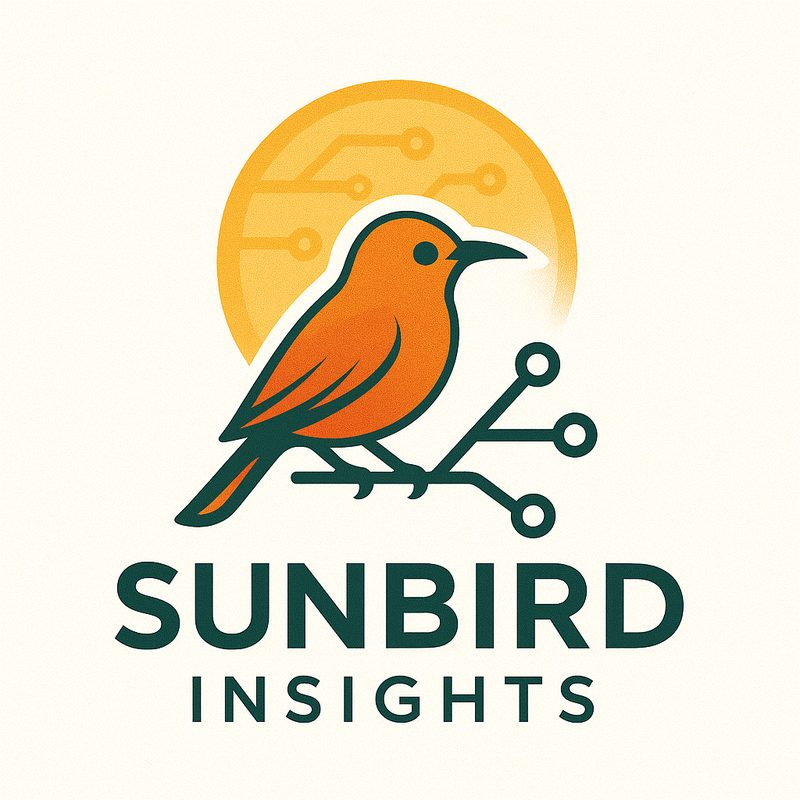

```{=html}
<style>
.handoff{display:grid;gap:2rem;align-items:center;max-width:960px;margin:1rem auto 3rem}
@media (min-width:760px){.handoff{grid-template-columns:minmax(0,2fr) minmax(0,3fr);gap:3rem}}
.handoff img{width:100%;max-width:360px;height:auto;border-radius:14px;box-shadow:0 2px 10px rgba(0,0,0,.08);margin:0 auto;display:block}
.handoff h2{margin-top:0}
.handoff .btn-cta{margin-top:.5rem}
.handoff-services{margin:0 0 1.25rem 1.2rem;padding:0;line-height:1.7}
.handoff .stay{color:#555;font-size:.95rem;margin-top:1.5rem}
</style>
<div class="handoff">

<div>
<h2>Consulting is now Sunbird Insights.</h2>
<p>My consulting practice has its own home: Sunbird Insights, LLC. The services, the way an engagement runs, and the way to start a conversation all live at sunbirds.ai.</p>
<ul class="handoff-services">
<li><a href="https://sunbirds.ai/#services">Sports analytics</a></li>
<li><a href="https://sunbirds.ai/#services">Training for data teams</a></li>
<li><a href="https://sunbirds.ai/#services">Coaching for individuals</a></li>
<li><a href="https://sunbirds.ai/#services">AI agents and reproducible pipelines</a></li>
<li><a href="https://sunbirds.ai/#services">Fractional data lead</a></li>
<li><a href="https://sunbirds.ai/#services">Statistical consulting and review</a></li>
</ul>
<a class="btn-cta" href="https://sunbirds.ai/">Go to sunbirds.ai</a>
<p class="stay">Workshops, talks, and the portfolio stay here on chesterismay.com.</p>
</div>
</div>
```
